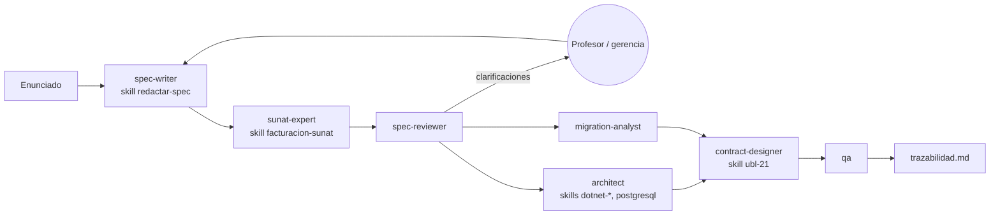

# Facturación electrónica ABC Software Corp — Kit Spec-First

Examen de medio curso de Arquitectura de Software, Grupo A, UNAS (19/10/2026). Fase 1 **Spec-First**: reglas, contratos de datos, validaciones e interfaces **antes de escribir código**. Por eso el repositorio solo contiene `specs/`, `.claude/agents/` y `.claude/skills/`; no hay carpetas de código.

## Entregable del enunciado → dónde está

| Ítem pedido (§4) | Archivo(s) |
|---|---|
| **1. Modelo de Dominio y Contratos (DTOs / Schemas)** | [`specs/domain/modelo-dominio.md`](specs/domain/modelo-dominio.md) · [`specs/contracts/schemas/`](specs/contracts/schemas/) (11 JSON Schema 2020-12) |
| **2. Diagramas de Arquitectura MVC con visión a Hexagonal** | [`specs/architecture/arquitectura.md`](specs/architecture/arquitectura.md) (C4 1 y 2, vista MVC, vista hexagonal, ruta de migración a microservicios, secuencia) · [ADR 0001](specs/adr/0001-arquitectura.md) |
| **3. Especificación de Endpoints / Servicios (Contratos API)** | [`specs/contracts/facturacion-api.yaml`](specs/contracts/facturacion-api.yaml) (OpenAPI 3.1) · [`specs/contracts/puertos.md`](specs/contracts/puertos.md) (puertos y contrato SUNAT) |
| **4. Matriz de Trazabilidad Normativa SUNAT ↔ UBL** | [`specs/traceability/matriz-normativa.md`](specs/traceability/matriz-normativa.md) (49 filas: dato → norma → catálogo → tag UBL → DTO → CA) · [`specs/traceability/trazabilidad.md`](specs/traceability/trazabilidad.md) (HU → RF → CA → UC → test) |
| Casos de uso (§3) | [`specs/use-cases/casos-de-uso.md`](specs/use-cases/casos-de-uso.md) |
| Legado y migración (§2) | [`specs/migration/mapeo-legado.md`](specs/migration/mapeo-legado.md) · [feature 003](specs/features/003-migrar-datos-legado/spec.md) |
| Catálogo 8 (§2, "punto clave") | Matriz fila 33 · [`modelo-dominio.md`](specs/domain/modelo-dominio.md) (`ConfigIsc`) · CA-09, CA-10 · skill [`facturacion-sunat`](.claude/skills/facturacion-sunat/SKILL.md) §2 |
| Distribución MSI / APK (§2) | [ADR 0004](specs/adr/0004-empaquetado-msi-apk.md) · RNF-04 |

## Orden de lectura
1. [`analisis-enunciado.md`](specs/analisis-enunciado.md) — qué dice el examen, sin agregar nada.
2. [`00-constitution.md`](specs/00-constitution.md) y [`glossary.md`](specs/glossary.md).
3. Specs: [001 emitir](specs/features/001-emitir-comprobante/spec.md) · [002 notas y bajas](specs/features/002-gestionar-notas-y-bajas/spec.md) · [003 migrar legado](specs/features/003-migrar-datos-legado/spec.md) · [004 registro de ventas](specs/features/004-generar-registro-ventas/spec.md), cada una con su `research.md`.
4. Entregables 1 a 4 (tabla de arriba).
5. ADR 0001 a 0004 y `review.md` de cada feature.

## Números

| Feature | HU | RF | RNF | CA | Clarificaciones |
|---|---|---|---|---|---|
| 001 Emitir comprobante | 6 | 17 | 7 | 27 | 8 |
| 002 Notas, bajas, resumen | 5 | 10 | 2 | 11 | 4 |
| 003 Migrar legado | 3 | 9 | 2 | 9 | 5 |
| 004 Registro de ventas y kardex | 2 | 5 | 1 | 5 | 3 |
| **Total** | **16** | **41** | **12** | **52** | **20** |

## Arquitectura y stack
- **Arquitectura** (origen: enunciado): monolito MVC cuyo Modelo es un núcleo hexagonal (Domain ← Application ← Infrastructure), con contextos acotados listos para separarse en microservicios. [ADR 0001](specs/adr/0001-arquitectura.md).
- **Stack** (origen: criterio, propuesta): C# .NET 10 — ASP.NET Core MVC en el servidor, .NET MAUI para Windows (MSI con WiX) y Android (APK), PostgreSQL. Elegido por XSD y XMLDSig nativos y un solo lenguaje cliente–servidor. [ADR 0002](specs/adr/0002-stack-tecnologico.md).

## Supuestos tomados
- Se envía directo a SUNAT (SEE-Del contribuyente), con un adaptador OSE intercambiable, hasta que se aclare el proveedor.
- Alcance: factura, boleta, notas, baja y resumen diario en venta interna (catálogo 51 = 0101), soles y dólares.
- Se adopta ya la regla "una nota modifica un solo comprobante" (vigente en SEE-OSE desde el 1/1/2027).
- El legado no tiene precios ni clientes; solo se migran movimientos de inventario.
- No se pudo crear la cuenta DEMO de Nubefact desde este entorno: los casos de uso se basan en su API pública y en guías SUNAT (pendiente confirmar).

## Cómo trabajan agentes y skills

| Agente | Produce | Skills |
|---|---|---|
| `spec-writer` | `spec.md` | `redactar-spec` |
| `sunat-expert` | `research.md`, `matriz-normativa.md` | `facturacion-sunat`, `ubl-21` |
| `spec-reviewer` | `review.md` | — |
| `migration-analyst` | `mapeo-legado.md` | — |
| `architect` | ADR, `arquitectura.md`, `modelo-dominio.md` | `dotnet-aspnetcore`, `dotnet-maui`, `postgresql` |
| `contract-designer` | `schemas/`, `facturacion-api.yaml`, `puertos.md` | `ubl-21` |
| `qa` | casos de prueba por CA, columna Test | `facturacion-sunat` |

Las **specs** dicen qué reglas de negocio cumplir; las **skills** dicen cómo ejecutarlas técnicamente; los **agentes** tienen un rol y un archivo del que son dueños.
