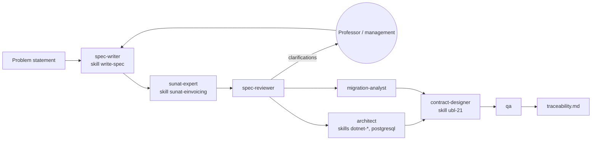

# ABC Software Corp electronic invoicing — Spec-First kit

Software Architecture mid-term exam, Group A, UNAS (19/10/2026). Phase 1 **Spec-First**: rules, data contracts, validations and interfaces **before writing code**. That is why the repository only contains `specs/`, `.claude/agents/` and `.claude/skills/`; there are no code folders.

## Problem statement deliverable → where it is

| Requested item (§4) | File(s) |
|---|---|
| **1. Domain Model and Contracts (DTOs / Schemas)** | [`specs/domain/domain-model.md`](specs/domain/domain-model.md) · [`specs/contracts/schemas/`](specs/contracts/schemas/) (11 JSON Schema 2020-12) |
| **2. MVC Architecture Diagrams with a Hexagonal vision** | [`specs/architecture/architecture.md`](specs/architecture/architecture.md) (C4 levels 1 and 2, MVC view, hexagonal view, Clean Architecture equivalence, migration path to microservices, sequence) · [ADR 0001](specs/adr/0001-architecture.md) |
| **3. Endpoint / Service Specification (API Contracts)** | [`specs/contracts/invoicing-api.yaml`](specs/contracts/invoicing-api.yaml) (OpenAPI 3.1) · [`specs/contracts/ports.md`](specs/contracts/ports.md) (ports and SUNAT contract) |
| **4. SUNAT ↔ UBL Regulatory Traceability Matrix** | [`specs/traceability/regulatory-matrix.md`](specs/traceability/regulatory-matrix.md) (49 rows: data → regulation → catalog → XSD cardinality → UBL tag → DTO → SUNAT error → AC) · [`specs/traceability/traceability.md`](specs/traceability/traceability.md) (US → FR → AC → UC → test) |
| Use cases (§3) | [`specs/use-cases/use-cases.md`](specs/use-cases/use-cases.md) |
| Legacy and migration (§2) | [`specs/migration/legacy-mapping.md`](specs/migration/legacy-mapping.md) · [feature 003](specs/features/003-migrate-legacy-data/spec.md) |
| Catalog 8 (§2, "key point") | Matrix row 33 · [`domain-model.md`](specs/domain/domain-model.md) (`IscConfig`) · AC-09, AC-10 · skill [`sunat-einvoicing`](.claude/skills/sunat-einvoicing/SKILL.md) §2 |
| MSI / APK distribution (§2) | [ADR 0004](specs/adr/0004-msi-apk-packaging.md) · NFR-04 |

## Reading order
1. [`problem-analysis.md`](specs/problem-analysis.md) — what the exam says, adding nothing.
2. [`00-constitution.md`](specs/00-constitution.md) and [`glossary.md`](specs/glossary.md).
3. Specs: [001 issue](specs/features/001-issue-document/spec.md) · [002 notes and voids](specs/features/002-manage-notes-and-voids/spec.md) · [003 migrate legacy](specs/features/003-migrate-legacy-data/spec.md) · [004 sales register](specs/features/004-generate-sales-register/spec.md), each with its `research.md`.
4. Deliverables 1 to 4 (table above).
5. ADR 0001 to 0004 and each feature's `review.md`.

## Numbers

| Feature | US | FR | NFR | AC | Clarifications |
|---|---|---|---|---|---|
| 001 Issue document | 6 | 17 | 7 | 27 | 8 |
| 002 Notes, voids, summary | 5 | 10 | 2 | 11 | 4 |
| 003 Migrate legacy | 3 | 9 | 2 | 9 | 5 |
| 004 Sales register and stock card | 2 | 5 | 1 | 5 | 3 |
| **Total** | **16** | **41** | **12** | **52** | **20** |

## Architecture and stack
- **Architecture** (origin: problem statement): MVC monolith whose Model is a hexagonal core (Domain ← Application ← Infrastructure), with bounded contexts ready to be split into microservices. [ADR 0001](specs/adr/0001-architecture.md).
- **Stack** (origin: judgment, proposal): C# .NET 10 — ASP.NET Core MVC on the server, .NET MAUI for Windows (MSI with WiX) and Android (APK), PostgreSQL. Chosen for native XSD and XMLDSig and a single client–server language. [ADR 0002](specs/adr/0002-technology-stack.md).

## Assumptions made
- Documents are sent directly to SUNAT (SEE-Del contribuyente), with a swappable OSE adapter, until the provider is clarified.
- Scope: invoice, sales receipt, notes, voiding and daily summary for domestic sales (catalog 51 = 0101), soles and dollars.
- The rule "a note modifies a single document" is adopted now (in force in SEE-OSE from 1/1/2027).
- The legacy system has no prices or customers; only inventory movements are migrated.

## How agents and skills work

| Agent | Produces | Skills |
|---|---|---|
| `spec-writer` | `spec.md` | `write-spec` |
| `sunat-expert` | `research.md`, `regulatory-matrix.md` | `sunat-einvoicing`, `ubl-21` |
| `spec-reviewer` | `review.md` | — |
| `migration-analyst` | `legacy-mapping.md` | — |
| `architect` | ADRs, `architecture.md`, `domain-model.md` | `dotnet-aspnetcore`, `dotnet-maui`, `postgresql` |
| `contract-designer` | `schemas/`, `invoicing-api.yaml`, `ports.md` | `ubl-21` |
| `qa` | test cases per AC, Test column | `sunat-einvoicing` |

**Specs** say which business rules to meet; **skills** say how to carry them out technically; **agents** have a role and a file they own.
