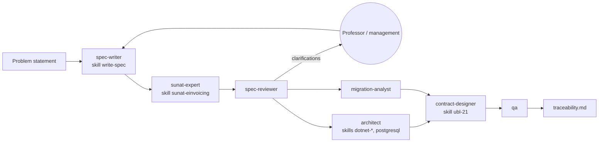

# ABC Software Corp electronic invoicing — Spec-First kit

[](https://github.com/juan745Guevara/Medio-curso-Hubel/actions/workflows/ci.yml)

## Second exam (2nd partial): XML generation from the Invoice 2.1 XSD — C# .NET 10

> **Entrega del 2.º parcial.** Generación del XML de la factura a partir de `UBL-Invoice-2.1.xsd` en el lenguaje del
> dominio (C# .NET 10, ADR 0002), con validación contra el XSD oficial y las reglas de SUNAT, firma, envío y **120 pruebas unitarias** (+1 de integración
> contra el beta real de SUNAT, que se activa a mano).

```bash
git clone https://github.com/juan745Guevara/Medio-curso-Hubel.git
cd Medio-curso-Hubel
dotnet test          # .NET SDK 10 — 120 tests: generation, XSD + SUNAT rules, signature, sending, domain, architecture
# with coverage: dotnet test --collect "Code Coverage" --settings coverage.runsettings --results-directory TestResults
```

Real submission to SUNAT's test service (needs internet). **Already done on 2026-11-04: SUNAT beta answered code 0,
"La Factura numero F001-93840690, ha sido aceptada"** and **"La Boleta numero B001-93854286, ha sido aceptada"** — signed XML and CDR in [`specs/examples/sunat-beta/`](specs/examples/sunat-beta/README.md):

```powershell
$env:SUNAT_BETA="1"; dotnet test --filter "FullyQualifiedName~SunatBetaTests"
```

| Step (class notes) | Where | How |
|---|---|---|
| **1. Generate the XML from the XSD 2.1 (Invoice)** — classes, not templates | [`src/Abc.Ubl/Generated/`](src/Abc.Ubl/Generated/) (classes generated from [`xsd/ubl-2.1/maindoc/UBL-Invoice-2.1.xsd`](xsd/ubl-2.1/maindoc/UBL-Invoice-2.1.xsd) with XmlSchemaClassGenerator, [`regenerate.sh`](src/Abc.Ubl/regenerate.sh)) · mapper [`Ubl21InvoiceGenerator`](src/Abc.Invoicing.Infrastructure/Ubl/Ubl21InvoiceGenerator.cs) | Domain `ElectronicDocument` → generated `InvoiceType` → `XmlSerializer` (ADR 0005). Order and cardinality come from the XSD; the SUNAT customization (catalog attributes, `FormaPago`, `TierRange`, legends…) follows the regulatory matrix rows cited in the code |
| **2. Validate the XML** against the official schema | [`OasisXsdValidator`](src/Abc.Invoicing.Infrastructure/Ubl/OasisXsdValidator.cs) | `XmlSchemaSet` over the official OASIS 2.1 OS XSDs that travel with the build; before signing and again after (ADR 0003). Then [`SunatRulesValidator`](src/Abc.Invoicing.Infrastructure/Ubl/SunatRulesValidator.cs) (FR-52): 28 SUNAT rules the XSD cannot express (series by type, catalog 51, currency, buyer RUC, totals, `FormaPago`, installments…), each with SUNAT's own code; 2000–3999 stop before signing, 4000+ are kept as observations |
| **3. Send the XML** | [`XmlDsigSigner`](src/Abc.Invoicing.Infrastructure/Signing/XmlDsigSigner.cs) · [`SunatBillServiceClient`](src/Abc.Invoicing.Infrastructure/Sunat/SunatBillServiceClient.cs) · use case [`IssueDocument`](src/Abc.Invoicing.Application/IssueDocument.cs) | XMLDSig enveloped in `ext:ExtensionContent` (ADR 0010), ZIP `RUC-01-F001-42.zip`, SOAP `sendBill` with WS-Security, CDR read by return-code range (FR-45). No answer → PENDING_RESEND; the retry ([`ResolvePendingSubmission`](src/Abc.Invoicing.Application/ResolvePendingSubmission.cs)) asks `getStatusCdr` first and resends the same signed file only if SUNAT has no CDR (ADR 0007). Unit tests use a fake SUNAT; `SunatBetaTests` sends to the real beta (`e-beta.sunat.gob.pe`, MODDATOS) |
| Domain rules | [`src/Abc.Invoicing.Domain/`](src/Abc.Invoicing.Domain/) | `TaxCalculator` (ISC catalog 08 before IGV, ICBPER, free lines), `Ruc` (modulo 11), `AmountInWords` (legend 1000), invariants of spec 001 |
| CI and coverage | [`.github/workflows/ci.yml`](.github/workflows/ci.yml) · [`coverage.runsettings`](coverage.runsettings) · [`tools/coverage_gate.py`](tools/coverage_gate.py) | On every push GitHub runs `validate_specs.py` and `dotnet test` with line coverage of Domain, Application and Infrastructure (the XSD-generated classes are excluded): 87 % today, the build fails below 80 % |
| Tests | [`tests/Abc.Invoicing.Tests/`](tests/Abc.Invoicing.Tests/) | `GenerationTests` (23), `ReferenceXmlTests` (10), `ValidationAndSigningTests` (8), `SunatRulesTests` (35), `SendingTests` (7), `PendingSubmissionTests` (7), `DomainTests` (26), `ArchitectureTests` (4) — 120 in total, plus `SunatBetaTests` (2, opt-in: invoice and sales receipt) |

The tests read the same JSON examples as the specs ([`specs/examples/valid/`](specs/examples/valid/)) and compare the
C# output with the signed reference XML of [`specs/examples/xml/`](specs/examples/xml/): one contract, two independent
implementations. Outside `dotnet test`, the signed C# output was also checked with libxmlsec1 and signxml (signature)
and lxml (XSD).

Architecture of the code = the hexagonal core of ADR 0001: `Domain` ← `Application` (ports `IUblGenerator`,
`IXsdValidator`, `ISunatRulesValidator`, `IXmlSigner`, `ISunatValidator`) ← `Infrastructure` (adapters, the only project that sees `Abc.Ubl`);
`ArchitectureTests` fails the build if that rule breaks.

Software Architecture mid-term exam, Group A, UNAS (19/10/2026). Phase 1 **Spec-First**: rules, data contracts, validations and interfaces **before writing code**. That is why the repository only contains `specs/`, `.claude/agents/` and `.claude/skills/`; there are no code folders.

## Problem statement deliverable → where it is

| Requested item (§4) | File(s) |
|---|---|
| **1. Domain Model and Contracts (DTOs / Schemas)** | [`specs/domain/domain-model.md`](specs/domain/domain-model.md) (class diagram with Invoicing, Catalog, Inventory, Migration, Registers and Configuration contexts; DailySummary, VoidingNotice, Outbox; life cycle by CDR return code) · [`specs/contracts/schemas/`](specs/contracts/schemas/) (17 JSON Schema 2020-12; enums are subsets of the SUNAT catalogs versioned as data in [`specs/catalogs/`](specs/catalogs/)) · [`specs/examples/`](specs/examples/README.md) (15 valid requests, 27 invalid ones with their expected error) |
| **2. MVC Architecture Diagrams with a Hexagonal vision** | [`specs/architecture/architecture.md`](specs/architecture/architecture.md) (C4 1 and 2, MVC view, hexagonal view, Clean Architecture equivalence, migration path, **target microservices** diagram, sequence in two transactions with outbox) · 14 diagrams (including the **deployment view**) exported to SVG/PNG in [`specs/architecture/diagrams/`](specs/architecture/diagrams/README.md) · ADR [0001](specs/adr/0001-architecture.md) to [0009](specs/adr/0009-amazonia-igv-exemption.md) |
| **3. Endpoint / Service Specification (API Contracts)** | [`specs/contracts/invoicing-api.yaml`](specs/contracts/invoicing-api.yaml) (OpenAPI 3.1, 29 operations, including goods receipts, product changes and SUNAT status on demand; 401/403 on all, 400 vs 422, 201/200/202/502/503 on issuance, binary downloads; Redocly and Spectral: 0 errors, 0 warnings) · [`specs/contracts/events.asyncapi.yaml`](specs/contracts/events.asyncapi.yaml) (AsyncAPI 3.1, 6 domain-event channels: the cut line to microservices) · [`specs/contracts/ports.md`](specs/contracts/ports.md) (input/output ports, `UblGeneratorPort`, `OutboxPort`, SUNAT contract) |
| **Open questions** | None: the 23 `[NEEDS CLARIFICATION]` were answered by the client as decisions D-01..D-21, each with its basis (official source or explicit choice), in [`specs/clarifications.md`](specs/clarifications.md) |
| **4. SUNAT ↔ UBL Regulatory Traceability Matrix** | [`specs/traceability/regulatory-matrix.md`](specs/traceability/regulatory-matrix.md) (70 SUNAT ↔ UBL rows: invoice, sales receipt, free-of-charge lines, exchange rate, notes, **daily summary RC** and **voiding notice RA** against SUNAT's own XSD; §G/§G2 SUNAT error and **CDR return-code ranges**; §I PLE 14.1 and §J PLE 12.1 with the UBL origin of every field; §K Catalog 03 ↔ Table 6; every one of the 176 SUNAT codes cited exists in [`sunat-return-codes.json`](specs/catalogs/sunat-return-codes.json)) · [`specs/traceability/traceability.md`](specs/traceability/traceability.md) (US → FR → AC → UC → test, 85 AC) |
| Use cases (§3) | [`specs/use-cases/use-cases.md`](specs/use-cases/use-cases.md) |
| Legacy and migration (§2) | [`specs/migration/legacy-mapping.md`](specs/migration/legacy-mapping.md) · [feature 003](specs/features/003-migrate-legacy-data/spec.md) |
| Catalog 8 (§2, "key point") | Matrix row 33 · [`catalog-08.json`](specs/catalogs/catalog-08.json) · `IscConfig` in the [domain](specs/domain/domain-model.md) · AC-09, AC-10, AC-68 · reference XML [`F001-44`](specs/examples/xml/20131312955-01-F001-44.xml) with systems 01, 02 and 03 in `TierRange` |
| PLE books 14.1 and 12.1 | [feature 004](specs/features/004-generate-sales-register/spec.md) · [`sales-register-row.schema.json`](specs/contracts/schemas/sales-register-row.schema.json) · [`stock-card.schema.json`](specs/contracts/schemas/stock-card.schema.json) · matrix §I–K · PLE tables 2, 5, 6, 10, 12, 13 in [`specs/catalogs/`](specs/catalogs/) |
| MSI / APK distribution (§2) | [ADR 0004](specs/adr/0004-msi-apk-packaging.md) · [ADR 0008](specs/adr/0008-server-numbering-series-per-point-of-issue.md) (numbering and signing only on the server) · NFR-04 |
| `UBL-Invoice-2.1.xsd` (§1) | [`xsd/`](xsd/README.md): the file of the statement plus every schema it imports, CreditNote, DebitNote, ApplicationResponse (CDR) and SUNAT's RC/RA schemas, with a hash manifest |

## How to verify it (executable spec)

```bash
pip install -r tools/requirements.txt
python tools/validate_specs.py          # 142 checks (144 with --lint): XSD hashes, schemas vs catalogs, valid/invalid examples,
                                        # reference XML (XSD + signature + amounts), ACs recalculated, OpenAPI,
                                        # AsyncAPI, FR/AC numbering, traceability, matrix codes, links, secrets
python tools/validate_specs.py --lint   # also Redocly + Spectral (needs Node.js)
python tools/ubl_build.py               # rebuilds the 9 signed reference XML from the JSON examples
python tools/render_diagrams.py         # re-exports the 14 Mermaid diagrams to SVG/PNG
```

`tools/` only verifies the specs; it is not product code (see [`CLAUDE.md`](CLAUDE.md)).

## Reading order
1. [`problem-analysis.md`](specs/problem-analysis.md) — what the exam says, adding nothing.
2. [`00-constitution.md`](specs/00-constitution.md) and [`glossary.md`](specs/glossary.md).
3. Specs: [001 issue](specs/features/001-issue-document/spec.md) · [002 notes and voids](specs/features/002-manage-notes-and-voids/spec.md) · [003 migrate legacy](specs/features/003-migrate-legacy-data/spec.md) · [004 sales register](specs/features/004-generate-sales-register/spec.md), each with its `research.md`.
4. Deliverables 1 to 4 (table above).
5. ADR 0001 to 0009 and each feature's `review.md`.
6. [`specs/examples/`](specs/examples/README.md) and `python tools/validate_specs.py`.

## Numbers

| Feature | US | FR | NFR | AC | Clarifications |
|---|---|---|---|---|---|
| 001 Issue document | 6 | 24 | 8 | 41 | 7 |
| 002 Notes, voids, summary | 5 | 10 | 2 | 13 | 4 |
| 003 Migrate legacy | 3 | 9 | 2 | 9 | 5 |
| 004 Sales register (PLE 14.1) and stock card (PLE 12.1) | 2 | 8 | 1 | 13 | 3 |
| **Total** | **16** | **51** | **13** | **76** | **19** |

## Architecture and stack
- **Architecture** (origin: problem statement): MVC monolith whose Model is a hexagonal core (Domain ← Application ← Infrastructure), with bounded contexts ready to be split into microservices. [ADR 0001](specs/adr/0001-architecture.md).
- **Stack** (origin: judgment, proposal): C# .NET 10 — ASP.NET Core MVC on the server, .NET MAUI for Windows (MSI with WiX) and Android (APK), PostgreSQL. Chosen for native XSD and XMLDSig and a single client–server language. The UBL XML is serialized from classes generated from the official XSDs ([ADR 0005](specs/adr/0005-ubl-from-xsd-generated-classes.md)). [ADR 0002](specs/adr/0002-technology-stack.md).

## Assumptions made
- Documents are sent directly to SUNAT (SEE-Del contribuyente), with a swappable OSE adapter, until the provider is clarified.
- Only the server numbers and signs; each till has its own Series; the app queues requests offline without numbers (ADR 0008).
- Issuance in two transactions with an outbox, so SUNAT's latency never holds the Series lock (ADR 0007).
- Scope: invoice, sales receipt, notes, voiding and daily summary for domestic sales (catalog 51 = 0101), soles and dollars.
- The rule "a note modifies a single document" is adopted now (in force in SEE-OSE from 1/1/2027).
- The legacy system has no prices or customers; only inventory movements are migrated.

## How agents and skills work



| Agent | Produces | Skills |
|---|---|---|
| `spec-writer` | `spec.md` | `write-spec` |
| `sunat-expert` | `research.md`, `regulatory-matrix.md` | `sunat-einvoicing`, `ubl-21` |
| `spec-reviewer` | `review.md` | — |
| `migration-analyst` | `legacy-mapping.md` | — |
| `architect` | ADRs, `architecture.md`, `domain-model.md` | `dotnet-aspnetcore`, `dotnet-maui`, `postgresql` |
| `contract-designer` | `schemas/`, `invoicing-api.yaml`, `ports.md` | `ubl-21` |
| `qa` | test cases per AC, Test column | `sunat-einvoicing` |

**Specs** say which business rules to meet; **skills** say how to carry them out technically; **agents** have a role and a file they own.
