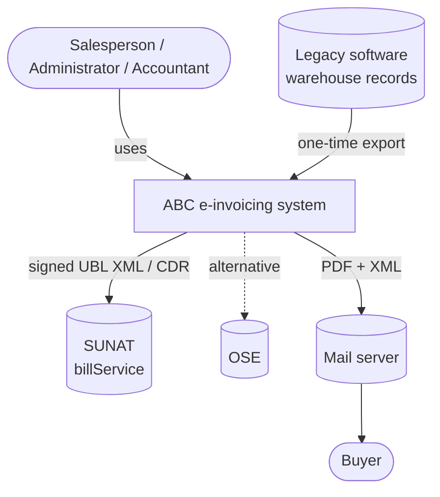
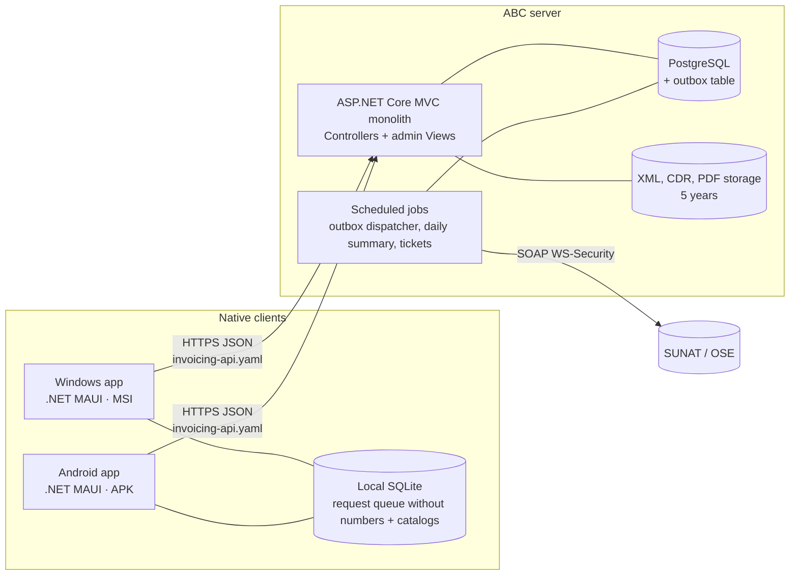
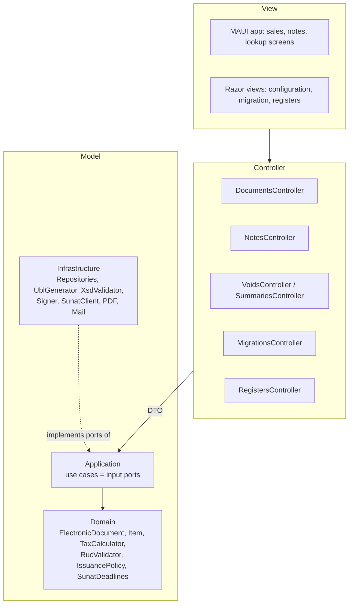
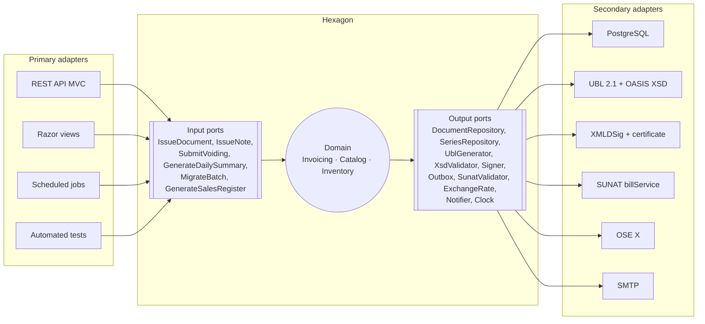
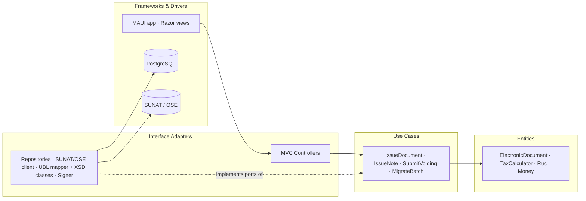
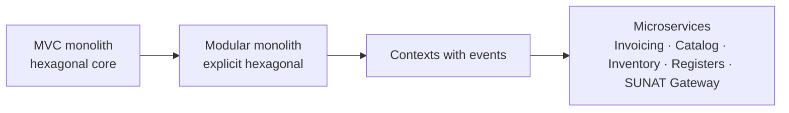
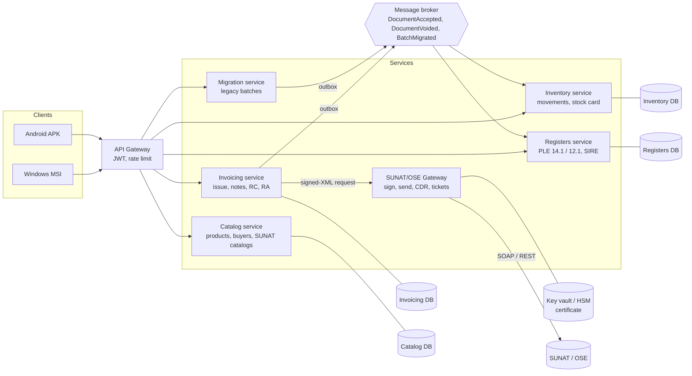
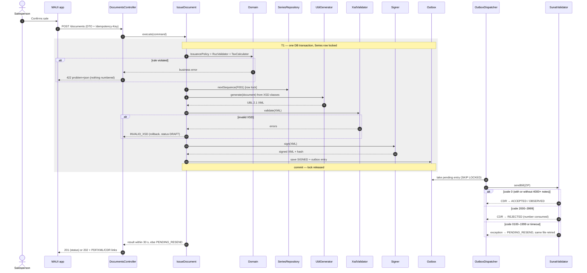
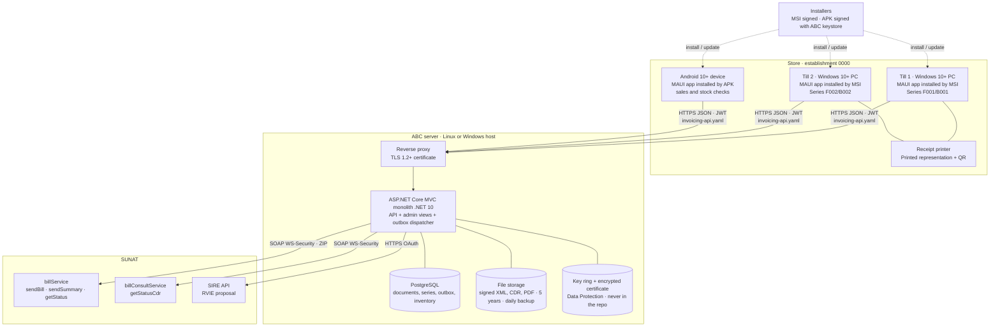

# Architecture: MVC with a Hexagonal vision

Deliverable 2 of the exam. Decisions in [ADR 0001](../adr/0001-architecture.md), [ADR 0002](../adr/0002-technology-stack.md), [ADR 0003](../adr/0003-validate-xsd-before-signing.md), [ADR 0004](../adr/0004-msi-apk-packaging.md), [ADR 0005](../adr/0005-ubl-from-xsd-generated-classes.md), [ADR 0006](../adr/0006-certificate-custody.md), [ADR 0007](../adr/0007-two-step-issuance-outbox.md) (two transactions + outbox), [ADR 0008](../adr/0008-server-numbering-series-per-point-of-issue.md) (numbering only on the server) and [ADR 0009](../adr/0009-amazonia-igv-exemption.md) (Amazonía).

Every diagram is also exported as SVG in [`diagrams/`](diagrams/) (`python tools/render_diagrams.py`).

The idea in one line: **today it is an MVC monolith; its "M" is already built as a hexagon**, so the future migration does not rewrite rules, it only relocates adapters.

## 1. C4 level 1 — Context



## 2. C4 level 2 — Containers



## 3. Initial view: MVC (what is built first)



Clean MVC rules the design requires:

1. The controller does not calculate, does not validate tax rules and does not touch the database: it maps the DTO and calls a use case.
2. The view never receives domain entities; it receives response DTOs.
3. The model knows nothing about HTTP, MAUI, PostgreSQL or SUNAT.

## 4. Target view: Hexagonal (ports and adapters)



Details of each port in [`contracts/ports.md`](../contracts/ports.md).

## 4b. Hexagonal or Clean: the same dependency rule

The problem statement asks to migrate "toward a Hexagonal Architecture or Clean Architecture". Both share the central rule: dependencies point toward the domain. This design serves both without changing core code; only the layer names change.

| Proposed project | MVC (today) | Hexagonal ([Cockburn](https://alistaircockburn.com/Articles/Hexagonal-Architecture)) | Clean Architecture (Robert C. Martin) | Examples in this system |
|---|---|---|---|---|
| `Abc.Invoicing.Domain` | Model (core) | Inside the hexagon: domain | **Entities** | `ElectronicDocument`, `Item`, `Ruc`, `Money`, `TaxCalculator`, `IssuancePolicy` |
| `Abc.Invoicing.Application` | Model (services) | Input ports (use cases) and output port definitions | **Use Cases** (interactors) and gateway interfaces | `IssueDocument`, `IssueNote`, `MigrateBatch`; `SunatValidatorPort`, `SignerPort` |
| `Abc.Invoicing.Web` (Controllers) | **Controller** | Primary (driving) adapters | **Interface Adapters**: controllers and presenters | `DocumentsController`, DTO ↔ use case mapping |
| `Abc.Invoicing.Web` (Views), `Abc.Client.Maui` | **View** | Primary adapters | **Frameworks & Drivers**: UI | Admin Razor views, Windows/Android app |
| `Abc.Invoicing.Infrastructure` | Model (data access) | Secondary (driven) adapters | **Interface Adapters** (gateways, repositories) + **Frameworks & Drivers** (DB, web) | `PostgresDocumentRepository`, `Ubl21Generator`, `OasisXsdValidator`, `SunatSoapClient`, `OseClient` |
| `Abc.Contracts` | View DTOs | Input port format | Request / Response models | `IssueDocumentRequest`, `ElectronicDocumentResponse` |



Arrows only cross the circles inward: `Entities` does not know `Use Cases`, and `Use Cases` knows neither the database nor SUNAT. It is the same dependency rule as [ADR 0001](../adr/0001-architecture.md), verified by an architecture test on every build.

## 5. Migration path

| Step | From | To | What changes | What does NOT change |
|---|---|---|---|---|
| 0 | — | MVC monolith with hexagonal core | Built this way from the start | — |
| 1 | Controllers + Infrastructure | Explicitly named primary and secondary adapters | Rename projects; register adapters by configuration | Domain, Application, API contracts |
| 2 | Internal calls between contexts | Domain events (`DocumentAccepted` → Inventory) | `EventsPort` moves from in-memory to a broker | Use cases |
| 3 | One deployment | Services per context: Invoicing, Catalog, Inventory, Registers | Each context with its own database and API | Ports and DTOs |
| 4 | SUNAT submission inside Invoicing | Isolated "SUNAT/OSE Gateway" service | `SunatValidatorPort` adapter becomes an HTTP client of the gateway | Invoicing domain |



### 5b. Target state: microservices (step 3–4)

Each bounded context becomes a service with its own database; they only talk through their APIs and the events of [`events.asyncapi.yaml`](../contracts/events.asyncapi.yaml), published from each service's outbox. The first service extracted is the SUNAT/OSE Gateway (strangler fig): it is the one with its own failure modes and release pace.



| Service | Owns | Publishes | Consumes |
|---|---|---|---|
| Invoicing | ElectronicDocument, Series, DailySummary, VoidingNotice | `DocumentAccepted`, `DocumentRejected`, `DocumentVoided` | — |
| SUNAT/OSE Gateway | Certificate use, submissions, CDR | `CdrReceived` | Signing/sending requests from Invoicing |
| Inventory | InventoryMovement | `StockChanged` | `DocumentAccepted` (outflow, FR-17), `DocumentVoided`, `BatchMigrated` |
| Registers | Read models of 14.1 and 12.1 | — | `DocumentAccepted`, `DocumentVoided`, `StockChanged` |
| Catalog | Product, Buyer, SUNAT catalogs | `ProductChanged` | — |
| Migration | MigrationBatch | `BatchMigrated` | — |

## 6. Sequence of the central flow (issue invoice)

Two transactions ([ADR 0007](../adr/0007-two-step-issuance-outbox.md)): T1 numbers and signs while it holds the Series row lock for milliseconds; T2 sends outside it. The client app never numbers or signs ([ADR 0008](../adr/0008-server-numbering-series-per-point-of-issue.md)).



## 6b. Deployment view (physical)

Where each piece runs (ADR 0002, ADR 0004, ADR 0006, ADR 0008; decisions D-13, D-14, D-18). The hosting of the server
(own machine in the main store or a rented VM) is chosen at go-live; the view is the same.



| Node | Runs | Talks to | Why there |
|---|---|---|---|
| Till PC (Windows, MSI) | MAUI client, local queue of unsent requests (no numbers) | Server over HTTPS | NFR-04; numbering and signing only on the server (FR-49, ADR 0008) |
| Android device (APK) | MAUI client | Server over HTTPS | NFR-04 |
| Server | Monolith, outbox dispatcher, scheduled jobs | PostgreSQL, storage, SUNAT | ADR 0001, ADR 0007; the certificate never leaves it (ADR 0006) |
| SUNAT | billService, billConsultService, SIRE | — | Direct SEE-Del contribuyente (D-13); an OSE replaces `bill`/`consult` by configuration (NFR-07) |

## 7. Proposed folder structure (described, not created in this phase)

```
src/
  Abc.Invoicing.Domain/          # entities, value objects, domain services — no dependencies
  Abc.Invoicing.Application/     # use cases (input ports) and output port interfaces
  Abc.Invoicing.Infrastructure/  # EF Core/PostgreSQL, UblMapper, XSD, XMLDSig, SUNAT/OSE client, PDF, SMTP
  Abc.Ubl/                       # classes generated from the OASIS UBL 2.1 and SUNAT XSDs (ADR 0005), never edited
  Abc.Invoicing.Web/             # ASP.NET Core MVC: Controllers, Views (admin), DI composition
  Abc.Contracts/                 # DTOs generated from specs/contracts/schemas (shared)
  Abc.Client.Maui/               # Windows (MSI) and Android (APK) app
  Abc.Installer.Wix/             # WiX project for the MSI
tests/
  Abc.Invoicing.Domain.Tests/        # one test per calculation and rule AC
  Abc.Invoicing.Architecture.Tests/  # ADR 0001 dependency rule
  Abc.Invoicing.Integration.Tests/   # XSD, signature, SUNAT beta
```

## 8. Which FRs each component covers

| Component | FR |
|---|---|
| TaxCalculator | FR-05, FR-06 |
| RucValidator, IssuancePolicy | FR-02, FR-03, FR-04, FR-12, FR-36 |
| SeriesRepository | FR-01 |
| UblMapper + generated UBL classes (ADR 0005) + AmountInWordsConverter | FR-07, FR-15 |
| XsdValidator | FR-08 |
| Signer | FR-09 |
| SunatValidator + Scheduled jobs | FR-10, FR-11, FR-23, FR-25, FR-26 |
| NotePolicy | FR-18 to FR-22 |
| PrintedRepresentation + Notifier | FR-13, FR-14 |
| Migration | FR-28 to FR-35 |
| Registers (PLE 14.1 and 12.1 writers) | FR-37 to FR-44 |
| ResponseCodeClassifier + OutboxDispatcher | FR-45, FR-50 |
| ExchangeRatePort | FR-46 |
| IgvTreatmentResolver, TaxCalculator (free lines, ISC per litre) | FR-47, FR-48 |
| PointOfIssue + SeriesRepository (server only) | FR-49, FR-51 |
