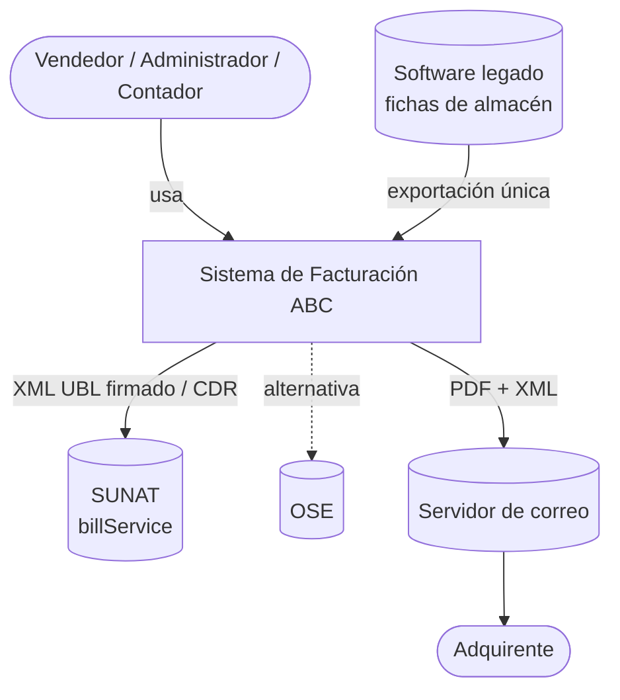
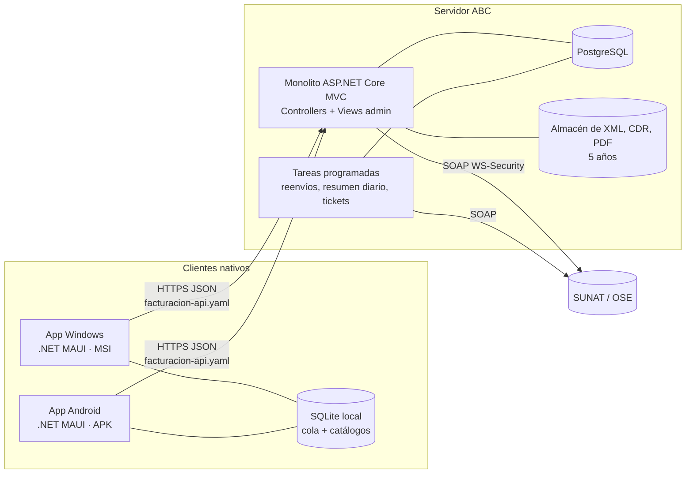
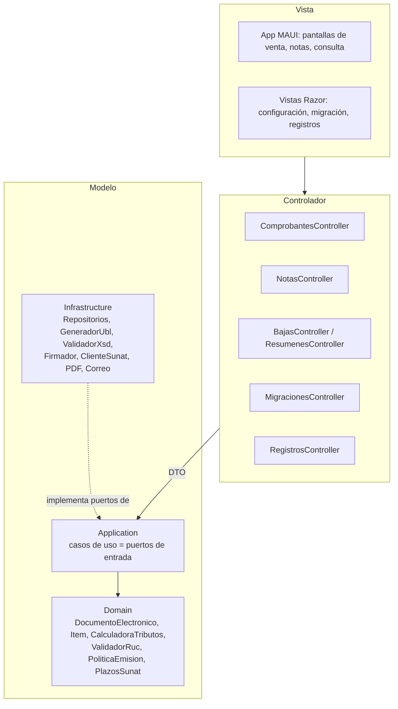
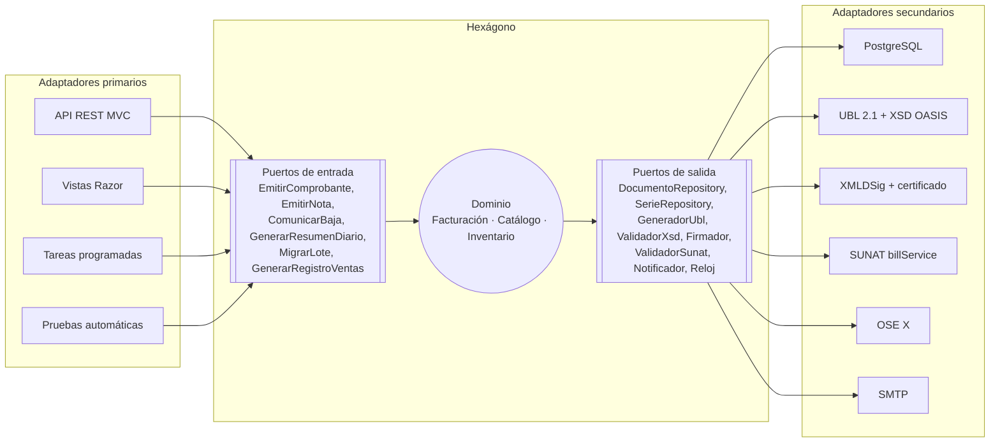
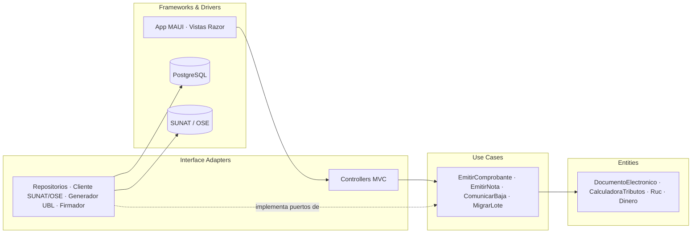
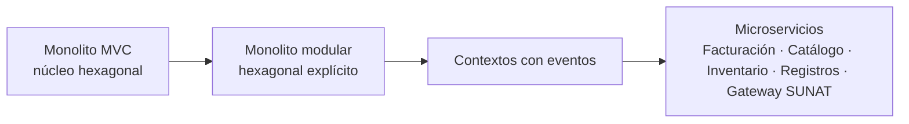
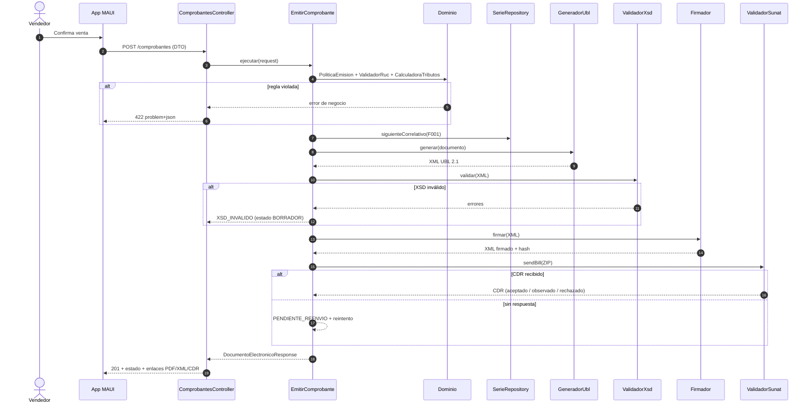

# Arquitectura: MVC con visión a Hexagonal

Entregable 2 del examen. Decisiones en [ADR 0001](../adr/0001-arquitectura.md), [ADR 0002](../adr/0002-stack-tecnologico.md), [ADR 0003](../adr/0003-validar-xsd-antes-de-firmar.md) y [ADR 0004](../adr/0004-empaquetado-msi-apk.md).

La idea en una línea: **hoy es un monolito MVC; su "M" ya está construida como un hexágono**, así que la migración futura no reescribe reglas, solo reubica adaptadores.

## 1. C4 nivel 1 — Contexto



## 2. C4 nivel 2 — Contenedores



## 3. Vista inicial: MVC (lo que se construye primero)



Reglas de MVC limpio que exige el diseño:

1. El controlador no calcula, no valida reglas tributarias y no toca la base de datos: mapea DTO y llama a un caso de uso.
2. La vista nunca recibe entidades de dominio; recibe DTO de respuesta.
3. El modelo no conoce HTTP, MAUI, PostgreSQL ni SUNAT.

## 4. Vista objetivo: Hexagonal (puertos y adaptadores)



Detalle de cada puerto en [`contracts/puertos.md`](../contracts/puertos.md).

## 4b. Hexagonal o Clean: la misma regla de dependencias

El enunciado pide migrar "hacia una Arquitectura Hexagonal o Clean Architecture". Las dos comparten la regla central: las dependencias apuntan hacia el dominio. Este diseño sirve para ambas sin cambiar código del núcleo; solo cambia el nombre de las capas.

| Proyecto propuesto | MVC (hoy) | Hexagonal ([Cockburn](https://alistaircockburn.com/Articles/Hexagonal-Architecture)) | Clean Architecture (Robert C. Martin) | Ejemplos en este sistema |
|---|---|---|---|---|
| `Abc.Facturacion.Domain` | Modelo (núcleo) | Dentro del hexágono: dominio | **Entities** | `DocumentoElectronico`, `Item`, `Ruc`, `Dinero`, `CalculadoraTributos`, `PoliticaEmision` |
| `Abc.Facturacion.Application` | Modelo (servicios) | Puertos de entrada (casos de uso) y definición de puertos de salida | **Use Cases** (interactors) e interfaces de gateways | `EmitirComprobante`, `EmitirNota`, `MigrarLote`; `ValidadorSunatPort`, `FirmadorPort` |
| `Abc.Facturacion.Web` (Controllers) | **Controlador** | Adaptadores primarios (driving) | **Interface Adapters**: controllers y presenters | `ComprobantesController`, mapeo DTO ↔ caso de uso |
| `Abc.Facturacion.Web` (Views), `Abc.Cliente.Maui` | **Vista** | Adaptadores primarios | **Frameworks & Drivers**: UI | Vistas Razor de administración, app Windows/Android |
| `Abc.Facturacion.Infrastructure` | Modelo (acceso a datos) | Adaptadores secundarios (driven) | **Interface Adapters** (gateways, repositorios) + **Frameworks & Drivers** (BD, web) | `PostgresDocumentoRepository`, `GeneradorUbl21`, `ValidadorXsdOasis`, `ClienteSoapSunat`, `ClienteOse` |
| `Abc.Contracts` | DTO de la Vista | Formato de los puertos de entrada | Request / Response models | `EmitirComprobanteRequest`, `DocumentoElectronicoResponse` |



Las flechas solo cruzan los círculos hacia dentro: `Entities` no conoce `Use Cases`, y `Use Cases` no conoce ni la base de datos ni SUNAT. Es la misma regla de dependencias del [ADR 0001](../adr/0001-arquitectura.md), que una prueba de arquitectura verifica en cada build.

## 5. Ruta de migración

| Paso | De | A | Qué cambia | Qué NO cambia |
|---|---|---|---|---|
| 0 | — | Monolito MVC con núcleo hexagonal | Se construye así desde el inicio | — |
| 1 | Controllers + Infrastructure | Adaptadores primarios y secundarios con nombre explícito | Renombrar proyectos; registrar adaptadores por configuración | Domain, Application, contratos API |
| 2 | Llamadas internas entre contextos | Eventos de dominio (`ComprobanteAceptado` → Inventario) | `EventosPort` pasa de memoria a broker | Casos de uso |
| 3 | Un despliegue | Servicios por contexto: Facturación, Catálogo, Inventario, Registros | Cada contexto con su base de datos y su API | Puertos y DTO |
| 4 | Envío a SUNAT dentro de Facturación | Servicio "Gateway SUNAT/OSE" aislado | Adaptador `ValidadorSunatPort` pasa a cliente HTTP del gateway | Dominio de facturación |



## 6. Secuencia del flujo central (emitir factura)



## 7. Estructura de carpetas propuesta (descrita, no creada en esta fase)

```
src/
  Abc.Facturacion.Domain/          # entidades, value objects, servicios de dominio — sin dependencias
  Abc.Facturacion.Application/     # casos de uso (puertos de entrada) e interfaces de puertos de salida
  Abc.Facturacion.Infrastructure/  # EF Core/PostgreSQL, UBL, XSD, XMLDSig, cliente SUNAT/OSE, PDF, SMTP
  Abc.Facturacion.Web/             # ASP.NET Core MVC: Controllers, Views (admin), composición DI
  Abc.Contracts/                   # DTO generados desde specs/contracts/schemas (compartidos)
  Abc.Cliente.Maui/                # app Windows (MSI) y Android (APK)
  Abc.Instalador.Wix/              # proyecto WiX para el MSI
tests/
  Abc.Facturacion.Domain.Tests/        # un test por CA de cálculo y reglas
  Abc.Facturacion.Architecture.Tests/  # regla de dependencias del ADR 0001
  Abc.Facturacion.Integration.Tests/   # XSD, firma, SUNAT beta
```

## 8. Qué RF cubre cada componente

| Componente | RF |
|---|---|
| CalculadoraTributos | RF-05, RF-06 |
| ValidadorRuc, PoliticaEmision | RF-02, RF-03, RF-04, RF-12, RF-36 |
| SerieRepository | RF-01 |
| GeneradorUbl + ConversorMontoLetras | RF-07, RF-15 |
| ValidadorXsd | RF-08 |
| Firmador | RF-09 |
| ValidadorSunat + Tareas programadas | RF-10, RF-11, RF-23, RF-25, RF-26 |
| PoliticaNotas | RF-18 a RF-22 |
| RepresentacionImpresa + Notificador | RF-13, RF-14 |
| Migración | RF-28 a RF-35 |
| Registros | RF-37 a RF-41 |
