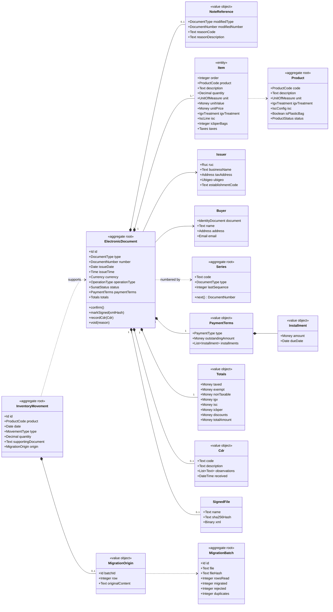
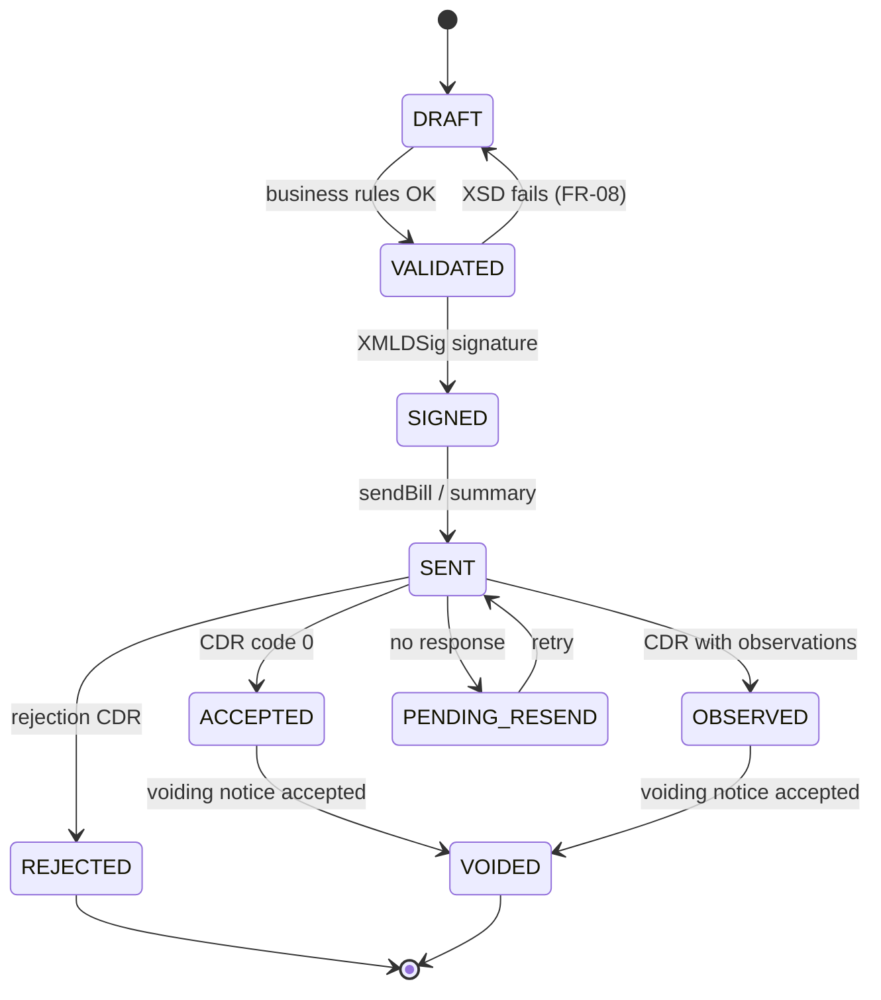

# Domain model

Deliverable 1 of the exam ("Domain Model" part). The contracts (DTOs/Schemas) are in [`../contracts/schemas/`](../contracts/schemas/). Logical types, no database-engine types.

## Bounded contexts

Separated from the start so that moving to microservices is just cutting along these lines (see [architecture](../architecture/architecture.md)).

| Context | Responsibility | Aggregates |
|---|---|---|
| **Invoicing** | Issue Electronic documents, calculate taxes, SUNAT status | ElectronicDocument, Series |
| **Catalog** | Products, customers, SUNAT catalogs | Product, Buyer, SunatCatalog |
| **Inventory** | Movements and stock card | InventoryMovement |
| **Migration** | Batches and traceability to legacy data | MigrationBatch |
| **Registers** | Sales register | (read view) |

## Class diagram

## Value objects and their rules

| Value object | Representation | Invariant | Source |
|---|---|---|---|
| `Ruc` | 11-digit text | Prefix 10/15/16/17/20 and modulo-11 check digit | FR-02 |
| `IdentityDocument` | type (cat. 06) + number | DNI 8 digits; RUC = `Ruc`; foreigner ID and passport up to 12 alphanumeric | FR-02, FR-04 |
| `DocumentNumber` | Series (4) + Sequence (1..99,999,999) | Series F### / B### by type; notes use the letter of the modified document | FR-01, FR-20 |
| `Money` | Exact decimal + Currency | Never floating point; half-up rounding to 2 decimals in totals | Constitution 7 |
| `Currency` | ISO 4217 code (cat. 02) | PEN or USD | FR-07 |
| `UnitOfMeasure` | UN/ECE Rec 20 code (cat. 03) | Must exist in the catalog | FR-07 |
| `IgvTreatment` | Cat. 07 code | 10–17 taxed, 20–21 exempt, 30–37 non-taxable, 40 export | FR-05 |
| `IscConfig` / `IscLine` | System (cat. 08) + rate or fixed amount | 01 → rate %; 02 → amount per unit; 03 → rate on retail sale price | FR-05 |
| `OperationType` | Cat. 51 code | 0101 in this scope | FR-07 |
| `PaymentTerms` | Cash / Credit | Credit ⇒ ≥ 1 Installment and Σ installments = outstandingAmount | FR-12 |

## Electronic document life cycle

## Domain services

| Service | What it does | FR |
|---|---|---|
| `TaxCalculator` | Calculates sale value, ISC (cat. 08), IGV, ICBPER and totals; pure, no dependencies | FR-05, FR-06 |
| `RucValidator` | Modulo 11 | FR-02 |
| `IssuancePolicy` | Pre-issuance rules: invoice needs RUC, sales receipt > S/ 700, credit with installments, classified product | FR-03, FR-04, FR-12, FR-36 |
| `NotePolicy` | One note one document, accepted document, credit cap | FR-19, FR-21, FR-22 |
| `SunatDeadlines` | Deadlines for submission, voiding, summary and contingency | FR-11, FR-16, FR-24, FR-25 |
| `AmountInWordsConverter` | Legend 1000 (in Spanish) | FR-15 |

## Domain events
`DocumentConfirmed`, `DocumentSigned`, `CdrReceived`, `DocumentAccepted`, `DocumentRejected`, `DocumentVoided`, `BatchMigrated`. Published in memory today; they are the cut line for future microservices.
