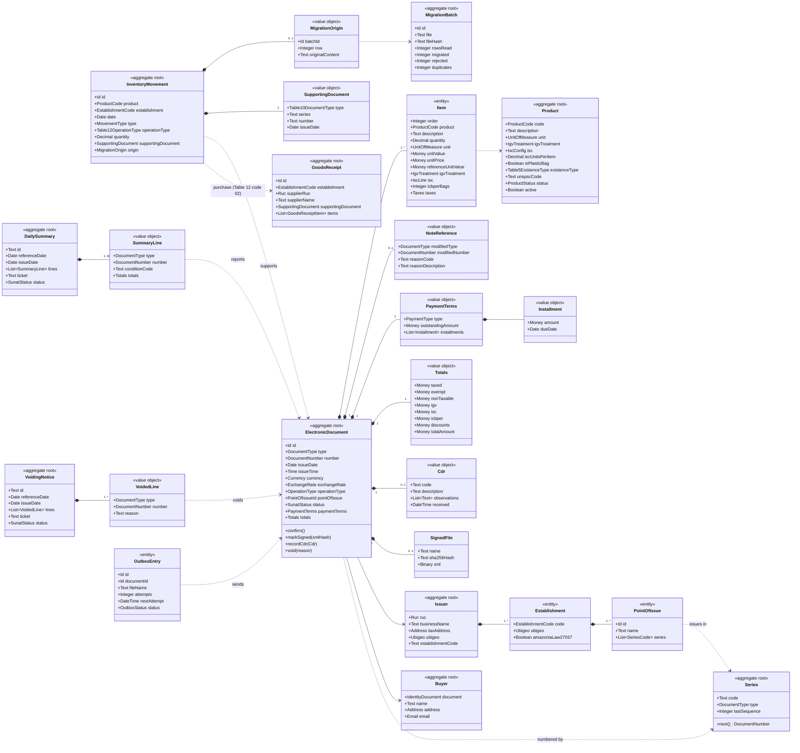
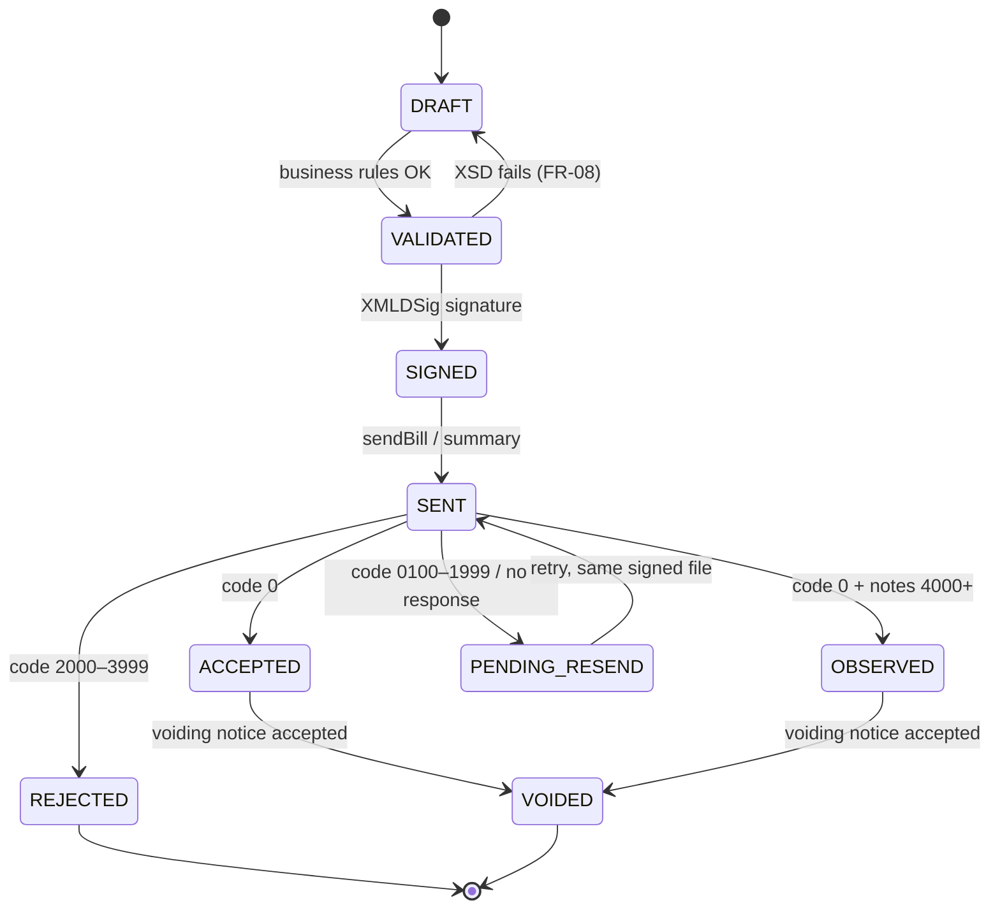

# Domain model

Deliverable 1 of the exam ("Domain Model" part). The contracts (DTOs/Schemas) are in [`../contracts/schemas/`](../contracts/schemas/). Logical types, no database-engine types.

## Bounded contexts

Separated from the start so that moving to microservices is just cutting along these lines (see [architecture](../architecture/architecture.md)).

| Context | Responsibility | Aggregates |
|---|---|---|
| **Invoicing** | Issue Electronic documents, calculate taxes, SUNAT status, daily summaries and voiding notices | ElectronicDocument, Series, DailySummary, VoidingNotice, OutboxEntry |
| **Configuration** | Issuer, establishments, points of issue, certificate | Issuer, Establishment, PointOfIssue |
| **Catalog** | Products, customers, SUNAT catalogs | Product, Buyer, SunatCatalog |
| **Inventory** | Movements, goods receipts (purchases, FR-53) and stock card | InventoryMovement, GoodsReceipt |
| **Migration** | Batches and traceability to legacy data | MigrationBatch |
| **Registers** | Sales register (PLE 14.1) and stock card (PLE 12.1) | (read views: SalesRegisterRow, StockCard) |

## Class diagram

## Value objects and their rules

| Value object | Representation | Invariant | Source |
|---|---|---|---|
| `Ruc` | 11-digit text | Prefix 10/15/16/17/20 and modulo-11 check digit | FR-02 |
| `IdentityDocument` | type (cat. 06) + number | DNI 8 digits; RUC = `Ruc`; foreigner ID and passport up to 12 alphanumeric | FR-02, FR-04 |
| `DocumentNumber` | Series (4) + Sequence (1..99,999,999) | Series F### / B### by type; notes use the letter of the modified document | FR-01, FR-20 |
| `Money` | Exact decimal + Currency | Never floating point; half-up rounding to 2 decimals in totals | Constitution 7 |
| `Currency` | ISO 4217 code (cat. 02) | PEN or USD | FR-07 |
| `UnitOfMeasure` | Closed enum of Catalog 03 (UN/ECE Rec 20) codes, 62 values in `common.schema.json` | Must be one of the enum values; each one has the same code in PLE Table 6 (matrix §K) | FR-07, FR-40 |
| `IgvTreatment` | Cat. 07 code | 10–17 taxed, 20–21 exempt, 30–37 non-taxable, 40 export | FR-05 |
| `IscConfig` / `IscLine` | System (cat. 08) + rate or fixed amount | 01 → rate %; 02 → amount per unit; 03 → rate on (suggested retail price × 0.847) | FR-05 |
| `OperationType` | Cat. 51 code | 0101 in this scope | FR-07 |
| `Table5ExistenceType` | PLE Table 5 code | 01 goods for resale by default; required before the Product is used in format 12.1 | FR-40 |
| `Table12OperationType` | PLE Table 12 code | 01 sale, 24 customer return, 16 opening balance, 99 other (legacy until classified) | FR-40, FR-42 |
| `SupportingDocument` | Table 10 type + series + number + date | Type 00 with series "0" for legacy rows; 01/03/07/08 for Electronic documents | FR-35, FR-40 |
| `EstablishmentCode` | 4-digit annex code of the RUC | Exists in the Issuer's establishments; same as `cbc:AddressTypeCode` | FR-40 |
| `PlePeriod` | AAAAMM00 | Month 01–12 | FR-37, FR-40 |
| `PaymentTerms` | Cash / Credit | Credit ⇒ ≥ 1 Installment and Σ installments = outstandingAmount | FR-12 |
| `ExchangeRate` | Decimal with 3 decimals + date | Required when currency = USD; > 0 | FR-46 |
| `referenceUnitValue` (Item) | `Money` | Required and > 0 when the IGV treatment is free of charge (11–16, 21, 31–37); then `unitValue` = 0 | FR-47 |
| `iscUnitsPerItem` (Product) | Decimal > 0 | Units of the ISC fixed amount contained in one sale unit (litres per bottle); default 1 | FR-48 |
| `SeriesCode` | 4 characters | `^F[A-Z0-9]{3}$` for 01, `^B[A-Z0-9]{3}$` for 03; belongs to one PointOfIssue; `lastSequence` never decreases | FR-49, FR-51 |
| `SummaryLine.conditionCode` | Catalog 19 | 1 add, 2 modify, 3 void | FR-25 |

## Electronic document life cycle

Transitions after SIGNED are applied by the outbox dispatcher ([ADR 0007](../adr/0007-two-step-issuance-outbox.md)) according to the return-code range ([`sunat-return-codes.json`](../catalogs/sunat-return-codes.json)). DailySummary and VoidingNotice follow `DRAFT → SIGNED → SENT (ticket) → ACCEPTED | REJECTED`; an accepted VoidingNotice moves each voided Document to VOIDED.

## Domain services

| Service | What it does | FR |
|---|---|---|
| `TaxCalculator` | Calculates sale value, ISC (cat. 08), IGV, ICBPER and totals; pure, no dependencies | FR-05, FR-06 |
| `RucValidator` | Modulo 11 | FR-02 |
| `IssuancePolicy` | Pre-issuance rules: invoice needs RUC, sales receipt > S/ 700, credit with installments, classified product | FR-03, FR-04, FR-12, FR-36 |
| `NotePolicy` | One note one document, accepted document, credit cap | FR-19, FR-21, FR-22 |
| `SunatDeadlines` | Deadlines for submission, voiding, summary and contingency | FR-11, FR-16, FR-24, FR-25 |
| `AmountInWordsConverter` | Legend 1000 (in Spanish) | FR-15 |
| `ResponseCodeClassifier` | Maps a SUNAT return code to ACCEPTED / OBSERVED / PENDING_RESEND / REJECTED by range | FR-45 |
| `IgvTreatmentResolver` | Product treatment, free-of-charge lines (FR-47) and the Amazonía rule of the establishment ([ADR 0009](../adr/0009-amazonia-igv-exemption.md)) | FR-05, FR-47 |

## Domain events
`DocumentConfirmed`, `DocumentSigned`, `CdrReceived`, `DocumentAccepted`, `DocumentRejected`, `DocumentVoided`, `BatchMigrated`. Written to the outbox in the same transaction as the change ([ADR 0007](../adr/0007-two-step-issuance-outbox.md)) and published in memory today; they are the cut line for future microservices. Their message contract is [`contracts/events.asyncapi.yaml`](../contracts/events.asyncapi.yaml).
