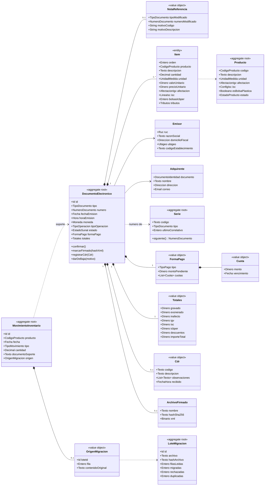
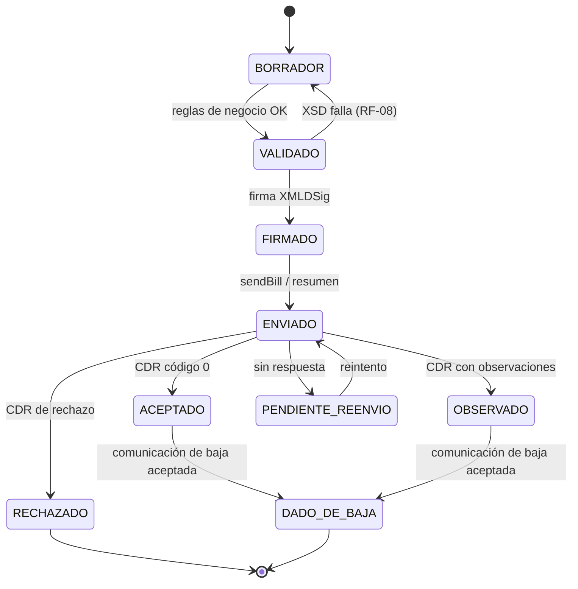

# Modelo de dominio

Entregable 1 del examen (parte "Modelo de Dominio"). Los contratos (DTOs/Schemas) están en [`../contracts/schemas/`](../contracts/schemas/). Tipos lógicos, sin tipos de un motor de base de datos.

## Contextos acotados

Se separan desde ya para que la migración a microservicios sea cortar por estas líneas (ver [arquitectura](../architecture/arquitectura.md)).

| Contexto | Responsabilidad | Agregados |
|---|---|---|
| **Facturación** | Emitir Documentos electrónicos, calcular tributos, estados SUNAT | DocumentoElectronico, Serie |
| **Catálogo** | Productos, clientes, catálogos SUNAT | Producto, Adquirente, CatalogoSunat |
| **Inventario** | Movimientos y kardex | MovimientoInventario |
| **Migración** | Lotes y trazabilidad al legado | LoteMigracion |
| **Registros** | Registro de ventas | (vista de lectura) |

## Diagrama de clases

## Value objects y sus reglas

| Value object | Representación | Invariante | Fuente |
|---|---|---|---|
| `Ruc` | Texto de 11 dígitos | Prefijo 10/15/16/17/20 y dígito verificador módulo 11 | RF-02 |
| `DocumentoIdentidad` | tipo (cat. 06) + número | DNI 8 dígitos; RUC = `Ruc`; CE y pasaporte hasta 12 alfanuméricos | RF-02, RF-04 |
| `NumeroDocumento` | Serie (4) + Correlativo (1..99 999 999) | Serie F### / B### según tipo; notas con la letra del modificado | RF-01, RF-20 |
| `Dinero` | Decimal exacto + Moneda | Nunca coma flotante; redondeo a 2 decimales en totales (half-up) | Constitución 7 |
| `Moneda` | Código ISO 4217 (cat. 02) | PEN o USD | RF-07 |
| `UnidadMedida` | Código UN/ECE Rec 20 (cat. 03) | Debe existir en catálogo | RF-07 |
| `AfectacionIgv` | Código cat. 07 | 10–17 gravado, 20–21 exonerado, 30–37 inafecto, 40 exportación | RF-05 |
| `ConfigIsc` / `LineaIsc` | Sistema (cat. 08) + tasa o monto fijo | 01 → tasa %; 02 → monto por unidad; 03 → tasa sobre precio de venta al público | RF-05 |
| `TipoOperacion` | Código cat. 51 | 0101 en este alcance | RF-07 |
| `FormaPago` | Contado / Crédito | Crédito ⇒ ≥ 1 Cuota y Σ cuotas = montoPendiente | RF-12 |

## Ciclo de vida del Documento electrónico

## Servicios de dominio

| Servicio | Qué hace | RF |
|---|---|---|
| `CalculadoraTributos` | Calcula valor de venta, ISC (cat. 08), IGV, ICBPER y totales; puro, sin dependencias | RF-05, RF-06 |
| `ValidadorRuc` | Módulo 11 | RF-02 |
| `PoliticaEmision` | Reglas previas: factura con RUC, boleta > S/ 700, crédito con cuotas, producto clasificado | RF-03, RF-04, RF-12, RF-36 |
| `PoliticaNotas` | Nota 1 a 1, comprobante aceptado, tope de crédito | RF-19, RF-21, RF-22 |
| `PlazosSunat` | Fecha límite de envío, baja, resumen y contingencia | RF-11, RF-16, RF-24, RF-25 |
| `ConversorMontoLetras` | Leyenda 1000 | RF-15 |

## Eventos de dominio
`ComprobanteConfirmado`, `ComprobanteFirmado`, `CdrRecibido`, `ComprobanteAceptado`, `ComprobanteRechazado`, `ComprobanteDadoDeBaja`, `LoteMigrado`. Hoy se publican en memoria; son el punto de corte para los microservicios futuros.
