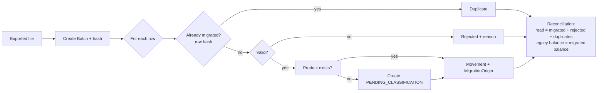

# Legacy-to-new-entity mapping

Covers the "Legacy and Data Migration" constraint and feature [003](../features/003-migrate-legacy-data/spec.md).

## Field by field

| Legacy field | New entity / attribute | Transformation | Rejection rule | FR |
|---|---|---|---|---|
| (row) | `MigrationOrigin.row` | Row number in the file | — | FR-30 |
| (whole row) | `MigrationOrigin.originalContent` | Original text unchanged | — | FR-30 |
| fecha (date) | `InventoryMovement.date` | Parsed with the agreed format (to be clarified) | Invalid or future date | FR-29, FR-32 |
| ingreso (inflow) | `InventoryMovement.quantity`, `type=INFLOW` | Exact decimal | Negative; inflow and outflow both > 0 | FR-29, FR-32 |
| salida (outflow) | `InventoryMovement.quantity`, `type=OUTFLOW` | Exact decimal | Negative; both zero | FR-29, FR-32 |
| producto (product) | `Product.code` / `Product.description` | Normalize spaces and case; look up; if missing create PENDING_CLASSIFICATION | Empty | FR-31, FR-32 |
| nro_documento (document no.) | `InventoryMovement.supportingDocument` = type `00` (Table 10, other), series `0`, number = original text (max 20); shown as `LEG:<text>` in the UI | Text as is | Longer than 20 characters ⇒ truncated in the PLE export only, original kept in `originalContent` | FR-35, FR-42 |
| (none) | `InventoryMovement.operationType` | `99` (Table 12, other) until the Administrator classifies it | — | FR-42 |
| (none) | `InventoryMovement.establishment` | Establishment chosen when uploading the batch (default `0000`) | — | FR-40 |
| (computed) | Opening balance row of the first period in operation | Legacy final balance per Product, operation `16`, entry number `A…` | — | FR-34, FR-42 |
| (file) | `MigrationBatch` | SHA-256 hash, counts | — | FR-28 |

## Flow

## What the migration does NOT do
- It does not create Electronic documents or Series from nro_documento (constitution 12).
- It does not assign IGV treatment or ISC: the Administrator decides (FR-36).
