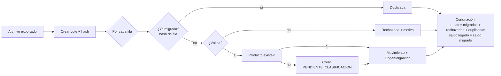

# Mapeo del legado a las entidades nuevas

Cubre la restricción "Legado y Migración de Datos" y la feature [003](../features/003-migrar-datos-legado/spec.md).

## Campo a campo

| Campo legado | Entidad / atributo nuevo | Transformación | Regla de rechazo | RF |
|---|---|---|---|---|
| (fila) | `OrigenMigracion.fila` | Número de fila del archivo | — | RF-30 |
| (fila completa) | `OrigenMigracion.contenidoOriginal` | Texto original sin cambios | — | RF-30 |
| fecha | `MovimientoInventario.fecha` | Parseo con formato acordado (por clarificar) | Fecha inválida o futura | RF-29, RF-32 |
| ingreso | `MovimientoInventario.cantidad`, `tipo=ENTRADA` | Decimal exacto | Negativo; ingreso y salida > 0 a la vez | RF-29, RF-32 |
| salida | `MovimientoInventario.cantidad`, `tipo=SALIDA` | Decimal exacto | Negativo; ambos en cero | RF-29, RF-32 |
| producto | `Producto.codigo` / `Producto.descripcion` | Normalizar espacios y mayúsculas; buscar; si no existe crear PENDIENTE_CLASIFICACION | Vacío | RF-31, RF-32 |
| nro_documento | `MovimientoInventario.documentoSoporte` | Texto tal cual, prefijado `LEG:` | — | RF-35 |
| (archivo) | `LoteMigracion` | Hash SHA-256, conteos | — | RF-28 |

## Flujo

## Lo que la migración NO hace
- No crea Documentos electrónicos ni Series a partir de nro_documento (constitución 12).
- No asigna Afectación IGV ni ISC: lo decide el Administrador (RF-36).
