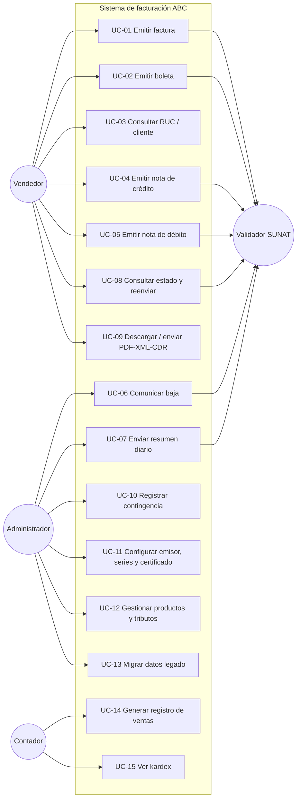

# Casos de uso

Fuente: enunciado §3, operaciones de la API de Nubefact (generar, consultar, anular y consultar anulación de comprobantes) y problemas frecuentes reportados en facturación electrónica (rechazos por datos mal calculados, caídas del servicio, plazos de envío, contingencia).

## Diagrama

## Catálogo

| ID | Caso de uso | Actor | Disparador | Flujo principal | Alternos / excepciones | RF |
|---|---|---|---|---|---|---|
| UC-01 | Emitir factura | Vendedor | Venta a cliente con RUC | Buscar Adquirente → agregar Ítems → elegir Forma de pago → confirmar → validar → XML → XSD → firmar → enviar → CDR → PDF | RUC inválido; crédito sin cuotas; XSD falla; rechazo; sin conexión → PENDIENTE_REENVIO | RF-01 a RF-15, RF-17 |
| UC-02 | Emitir boleta | Vendedor | Venta a consumidor final | Igual a UC-01 sin envío individual (va a Resumen diario) | > S/ 700 sin documento | RF-01, RF-04 a RF-09, RF-13, RF-15, RF-17 |
| UC-03 | Consultar RUC / cliente | Vendedor | Ingreso de documento | Validar formato y dígito verificador → buscar en clientes | RUC inválido | RF-02 |
| UC-04 | Emitir nota de crédito | Vendedor | Devolución, descuento, error | Elegir Comprobante → motivo cat. 09 → Ítems → emitir | Comprobante no aceptado; exceso de crédito | RF-18 a RF-22 |
| UC-05 | Emitir nota de débito | Vendedor | Intereses, aumento | Elegir Comprobante → motivo cat. 10 → emitir | Comprobante no aceptado | RF-18 a RF-21 |
| UC-06 | Comunicar baja | Administrador | Comprobante emitido por error | Elegir → motivo → Comunicación de baja → Ticket → CDR | Fuera de plazo → usar NC | RF-23, RF-24 |
| UC-07 | Enviar resumen diario | Sistema / Administrador | Cierre del día | Agrupar Boletas y Notas → bloques de 500 → enviar → Ticket | Ticket en proceso; rechazo | RF-25, RF-26 |
| UC-08 | Consultar estado y reenviar | Vendedor | Duda o alerta | Buscar → ver Estado SUNAT y CDR → reenviar pendientes | Plazo por vencer | RF-11, RF-27 |
| UC-09 | Descargar / enviar documentos | Vendedor | Cliente pide copia | Descargar PDF, XML, CDR o enviar por correo | Sin correo registrado | RF-13, RF-14 |
| UC-10 | Registrar contingencia | Administrador | Caída documentada | Activar → registrar comprobantes físicos → informe ≤ 7 días | Fuera de plazo | RF-16 |
| UC-11 | Configurar emisor | Administrador | Puesta en marcha | RUC, razón social, domicilio, Series, Certificado, SUNAT/OSE, beta/producción | Certificado vencido | RNF-05, RNF-07 |
| UC-12 | Gestionar productos | Administrador | Alta o cambio | Código, descripción, unidad (cat. 03), Afectación IGV (cat. 07), Sistema ISC (cat. 08), bolsa ICBPER | Producto PENDIENTE_CLASIFICACION | RF-05, RF-36 |
| UC-13 | Migrar legado | Administrador | Implantación | Cargar archivo → Lote → validar filas → migrar → conciliar | Filas rechazadas; duplicadas | RF-28 a RF-36 |
| UC-14 | Registro de ventas | Contador | Cierre de mes | Elegir Periodo → listar → exportar | Documentos pendientes | RF-37 a RF-39, RF-41 |
| UC-15 | Ver kardex | Contador / Administrador | Control de stock | Elegir Producto → movimientos y saldo | — | RF-40 |

## Lo que dicen los usuarios (y cómo lo cubre el diseño)

| Problema frecuente | Cobertura |
|---|---|
| Rechazos por totales mal calculados o redondeos | Cálculo centralizado en el dominio (RF-05, RF-06) y validación XSD previa (RF-08) |
| Caídas del servicio de SUNAT/OSE en horas pico | Cola con reintento y Estado PENDIENTE_REENVIO (RF-11) |
| Olvidar el plazo de envío | Alertas de plazo (RF-11, CA-20) |
| No saber por qué rechazaron | Mostrar código y descripción del CDR (RF-10, RF-27) |
| Necesitar emitir sin internet | Contingencia (RF-16) y clarificación sobre modo offline |
| Cambio de proveedor OSE | Puerto `ValidadorSunatPort` con adaptadores intercambiables (ADR 0001) |

## Clarificaciones
- [NEEDS CLARIFICATION] ¿El Vendedor puede emitir notas, o solo el Administrador?
