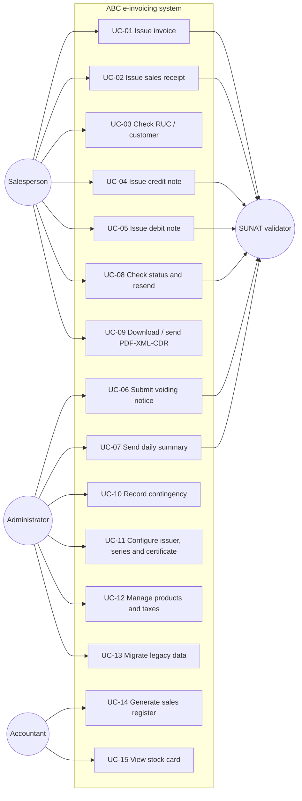

# Use cases

Source: problem statement §3, Nubefact API operations (generate, query, void and query voiding of documents) and frequent problems reported in e-invoicing (rejections due to miscalculated data, service outages, submission deadlines, contingency).

## Diagram

## Catalog

| ID | Use case | Actor | Trigger | Main flow | Alternatives / exceptions | FR |
|---|---|---|---|---|---|---|
| UC-01 | Issue invoice | Salesperson | Sale to a customer with RUC | Find Buyer → add Items → choose Payment terms → confirm → validate → XML → XSD → sign → send → CDR → PDF | Invalid RUC; credit without installments; XSD fails; rejection; no connection → PENDING_RESEND | FR-01 to FR-15, FR-17 |
| UC-02 | Issue sales receipt | Salesperson | Sale to a final consumer | Same as UC-01 without individual submission (goes to Daily summary) | > S/ 700 without document | FR-01, FR-04 to FR-09, FR-13, FR-15, FR-17 |
| UC-03 | Check RUC / customer | Salesperson | Document entered | Validate format and check digit → look up customers | Invalid RUC | FR-02 |
| UC-04 | Issue credit note | Salesperson | Return, discount, error | Choose Document → catalog 09 reason → Items → issue | Document not accepted; excess credit | FR-18 to FR-22 |
| UC-05 | Issue debit note | Salesperson | Interest, increase | Choose Document → catalog 10 reason → issue | Document not accepted | FR-18 to FR-21 |
| UC-06 | Submit voiding notice | Administrator | Document issued by mistake | Choose → reason → Voiding notice → Ticket → CDR | Past the deadline → use CN | FR-23, FR-24 |
| UC-07 | Send daily summary | System / Administrator | End of day | Group Sales receipts and Notes → blocks of 500 → send → Ticket | Ticket in progress; rejection | FR-25, FR-26 |
| UC-08 | Check status and resend | Salesperson | Doubt or alert | Search → see SUNAT status and CDR → resend pending | Deadline about to expire | FR-11, FR-27 |
| UC-09 | Download / send documents | Salesperson | Customer asks for a copy | Download PDF, XML, CDR or send by e-mail | No e-mail registered | FR-13, FR-14 |
| UC-10 | Record contingency | Administrator | Documented outage | Activate → record paper documents → report ≤ 7 days | Past the deadline | FR-16 |
| UC-11 | Configure issuer | Administrator | Go-live | RUC, business name, address, Series, Certificate, SUNAT/OSE, beta/production | Expired certificate | NFR-05, NFR-07 |
| UC-12 | Manage products | Administrator | Create or change | Code, description, unit (cat. 03), IGV treatment (cat. 07), ISC system (cat. 08), ICBPER bag | Product PENDING_CLASSIFICATION | FR-05, FR-36 |
| UC-13 | Migrate legacy data | Administrator | Implementation | Upload file → Batch → validate rows → migrate → reconcile | Rejected rows; duplicates | FR-28 to FR-36 |
| UC-14 | Sales register and inventory register | Accountant | Month-end | Choose Period → list in format 14.1 / 12.1 → export PLE TXT | Pending documents; Product without Table 5 stock type | FR-37 to FR-39, FR-41 to FR-44 |
| UC-15 | View stock card | Accountant / Administrator | Stock control | Choose Product, Period and establishment → format 12.1 movements and running balance | — | FR-40 |

## What users report (and how the design covers it)

| Frequent problem | Coverage |
|---|---|
| Rejections due to miscalculated totals or rounding | Calculation centralized in the domain (FR-05, FR-06) and prior XSD validation (FR-08) |
| SUNAT/OSE service outages at peak hours | Queue with retry and PENDING_RESEND status (FR-11) |
| Forgetting the submission deadline | Deadline alerts (FR-11, AC-20) |
| Not knowing why it was rejected | Show CDR code and description (FR-10, FR-27) |
| Needing to issue without internet | Contingency (FR-16) and offline-mode clarification |
| Changing OSE provider | `SunatValidatorPort` port with interchangeable adapters (ADR 0001) |

## Clarifications
- [NEEDS CLARIFICATION] May the Salesperson issue notes, or only the Administrator?
